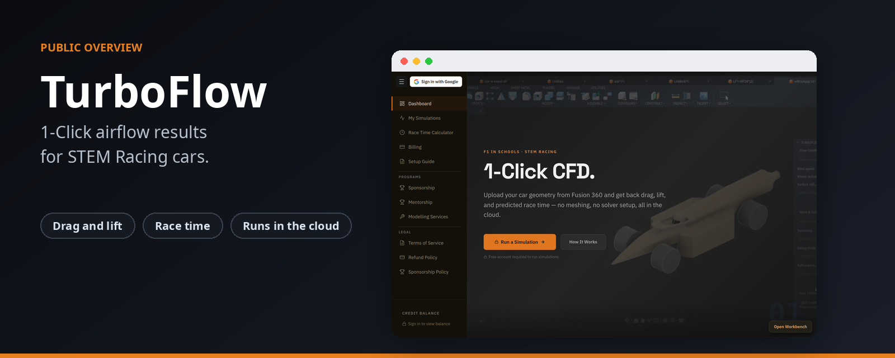
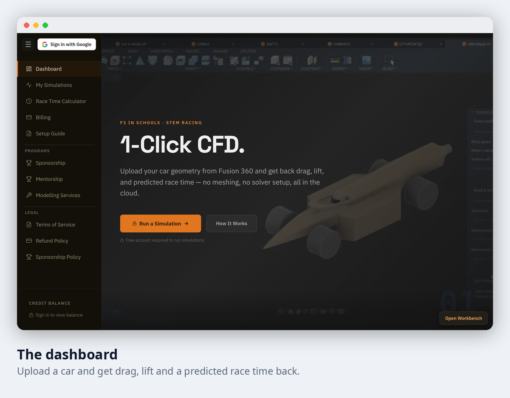

# TurboFlow

**1-Click airflow results for STEM Racing cars.**

Upload your car design and get back drag, lift and a predicted race time. There is no meshing and no solver setup, and it all runs in the cloud.

| | |
|---|---|
| **Built for** | F1 in Schools and STEM Racing teams |
| **You provide** | Your car geometry from Fusion 360 |
| **You get back** | Drag, lift and a predicted race time |
| **Cost** | A free account is needed to run simulations |

## The goal

Airflow testing is slow and hard to set up, and most student teams do not have the software or the time. TurboFlow takes the setup away, so a team can test a design in a few clicks and compare it with the last version.

## A look inside

## What is inside

| Area | What it gives you |
|---|---|
| Dashboard | Start a simulation and see where you are. |
| My Simulations | Every run you have made, so you can compare versions. |
| Race Time Calculator | Turns an air resistance figure into time on the track. |
| Setup Guide | A short guide to get your first simulation running. |
| Programs | Sponsorship, mentorship and modelling services for teams. |

## Who it is for

Student teams and mentors who want airflow results without learning simulation software.

## Status

| | |
|---|---|
| Project | Active |
| Source code | Private |
| This repository | Overview only, with no code |

## Credits

Made by [@Shashanksaraswat123939](https://github.com/Shashanksaraswat123939).

## Rights

This page is a public overview of a private project. It contains no source code and does not describe how the project is built.

All rights reserved. You are welcome to read this page and share the link. You may not copy, reproduce or recreate the project from this material, and you may not use it to train, prompt or instruct automated systems to produce a copy. See the [LICENSE](LICENSE) file.
